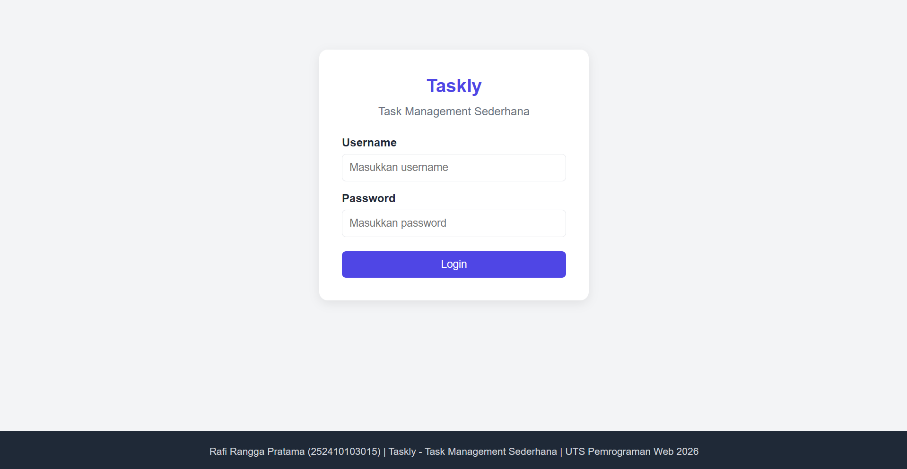
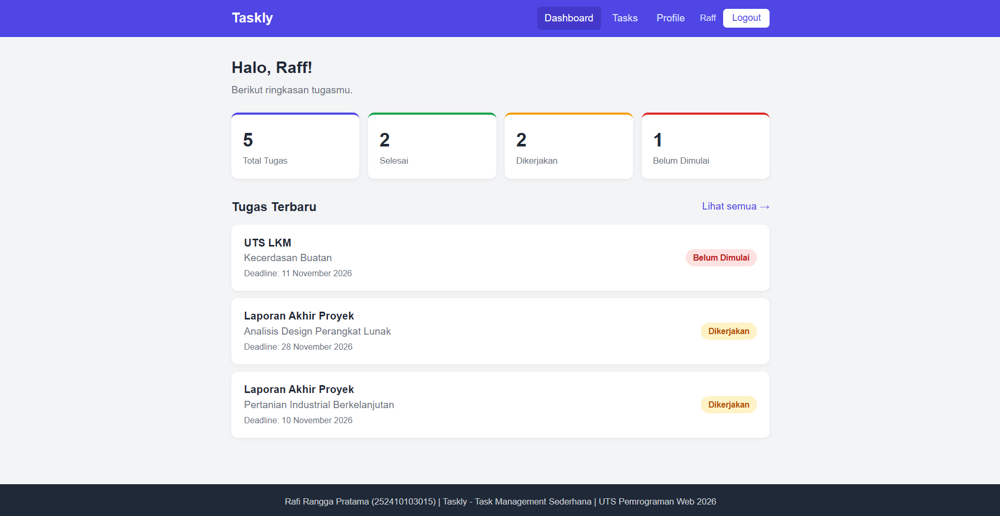
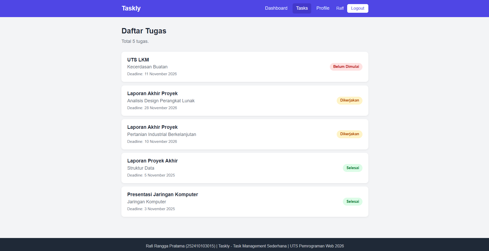
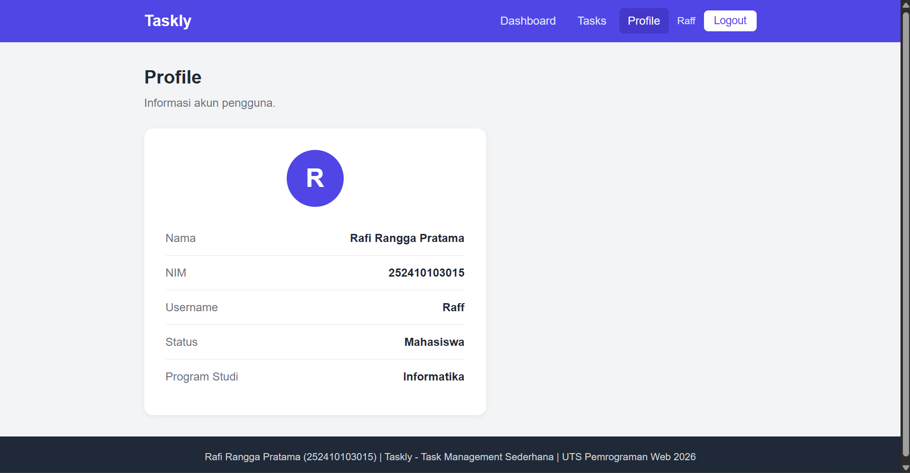

# Taskly - Simple Task Management

UTS Pemrograman Web 2026

- **Nama**  : Rafi Rangga Pratama
- **NIM**   : 252410103015

## Tentang Website

Taskly adalah website sederhana untuk menampilkan dan memantau daftar tugas kuliah harian mahasiswa.
Tema pengelolaan yang dipilih adalah **Task Management Sederhana**.

Website dibuat menggunakan **Laravel** dengan arsitektur MVC dan **Blade Template**, tanpa database.
Data tugas berasal dari array PHP di Controller.

## Fitur

- Login dengan username dan password (menggunakan session Laravel)
- Dashboard berisi sapaan, ringkasan jumlah tugas, dan tugas terbaru
- Halaman Tasks berisi daftar tugas (nama, mata kuliah, deadline, status)
- Halaman Profile berisi data pengguna
- Logout dan proteksi halaman (belum login akan diarahkan ke halaman Login)
- Tampilan responsif

## Akun Demo

- Username: `Raff`
- Password: `ayo123`

## Cara Menjalankan

    composer install
    copy .env.example .env
    php artisan key:generate
    php artisan serve

Lalu buka `http://127.0.0.1:8000` di browser.
Pastikan di file `.env` terdapat `SESSION_DRIVER=file`.

## Screenshot

### Login

### Dashboard

### Tasks

### Profile
